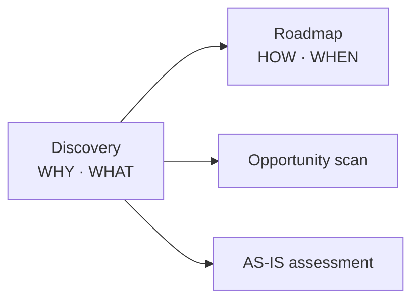

# AI Strategy & Operating Model Approach

> AE engagement approach for defining a Digital & AI strategy and the operating model to deliver it. Source: "AI Strategy and Operating Model" project team kickoff, 2026-02-09.

## What it is

The umbrella methodology for an AI strategy engagement. It couples two workstreams — **Digital & AI strategy definition** and a **Transformation operating model** — and runs them through two phases, **Discovery** and **Roadmap**, structured around four questions: **WHY → WHAT → HOW → WHEN**.

## When to use it

At the start of an AI strategy or transformation engagement, to frame the work and align a project team on phases and deliverables before diving into detail.

## Structure / steps

- **Discovery** — establish the *WHY* and *WHAT*. Runs an **Opportunity scan** and an **AS-IS** assessment of the current state.
- **Roadmap** — establish the *HOW* and *WHEN*. Sequences initiatives into a delivery plan.

The Opportunity scan is the analytical core, and uses three linked lenses:
- [[AI Value Creation — Three Ways to Add Value]] — *what kind* of value (improve / wrap / create).
- [[Three Levels of AI Ambition]] — *how far* to reach (individual → activity → business-process).
- [[AI Value Creation Funnel]] — *how* to move ideas from ideation to running.

## Diagram

## Inputs & outputs

- **Inputs:** business context, current-state (AS-IS) assessment, stakeholder input.
- **Outputs:** a defined Digital & AI strategy and a transformation operating model, expressed as a prioritised roadmap.

## References

- AE "AI Strategy and Operating Model" project team kickoff deck, 2026-02-09.

## Links

- [[AI Operating Model]] — this approach produces / populates that target operating model.
- [[AI Value Creation — Three Ways to Add Value]]
- [[Three Levels of AI Ambition]]
- [[AI Value Creation Funnel]]
