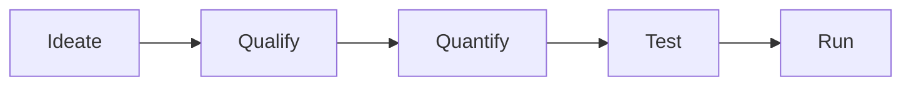

# AI Value Creation Funnel

> One of three lenses in the Opportunity scan. Source: "AI Strategy and Operating Model" kickoff, 2026-02-09.

## What it is

A staged funnel for moving AI opportunities from raw idea to running solution, progressively filtering on feasibility and value: **Ideate → Qualify → Quantify → Test → Run.**

## When to use it

During an Opportunity scan, to structure a pipeline of AI ideas and apply increasing scrutiny at each stage rather than committing to everything up front.

## Structure / steps

1. **Ideate** — generate candidate ideas.
2. **Qualify** — filter for fit and feasibility.
3. **Quantify** — estimate value and effort.
4. **Test** — pilot / validate.
5. **Run** — put into production and operate.

Feeding the funnel:
- **Training and tools** — capability inputs that raise the quality and volume of ideas.
- **Disruptive ideas: business model redesign** — the high-ambition end of the pipeline (links to the *Create* mode in [[AI Value Creation — Three Ways to Add Value]] and business-process transformation in [[Three Levels of AI Ambition]]).

## Diagram

## Inputs & outputs

- **Inputs:** raw opportunities, enablement (training & tools).
- **Outputs:** a filtered, validated set of AI initiatives ready to run.

## References

- AE "AI Strategy and Operating Model" kickoff deck, 2026-02-09.

## Links

- [[AI Strategy & Operating Model Approach]] — parent methodology.
- [[AI Value Creation — Three Ways to Add Value]]
- [[Three Levels of AI Ambition]]
- [[AI Operating Model]]
