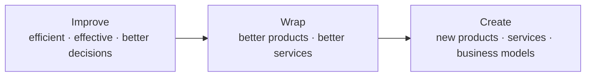

# AI Value Creation — Three Ways to Add Value

> One of three lenses in the Opportunity scan. Source: "AI Strategy and Operating Model" kickoff, 2026-02-09.

## What it is

A framework naming three fundamentally different ways AI/data can create value, in increasing order of ambition and disruption: **Improve → Wrap → Create**.

## When to use it

During an Opportunity scan, to classify candidate AI use cases by the *type* of value they create and to make sure a portfolio isn't skewed to only one mode.

## Structure / steps

1. **Improve** — use AI internally to work better: *more efficient, more effective, better decisions.*
2. **Wrap** — enhance existing offerings: *better products, better services.*
3. **Create** — build genuinely new value: *new products, new services, new business models.*

## Diagram

## Inputs & outputs

- **Inputs:** a list of candidate use cases or opportunities.
- **Outputs:** each opportunity tagged Improve / Wrap / Create, informing prioritisation and ambition-setting.

## References

- Wixom et al. 2023, *Creating Value From Data: A Monetization Framework* (basis for Improve/Wrap/Create).
- Borges et al. 2021, *The strategic use of artificial intelligence in the digital era: Systematic literature review and future research directions.*
- AE "AI Strategy and Operating Model" kickoff deck, 2026-02-09.

## Links

- [[AI Strategy & Operating Model Approach]] — parent methodology.
- [[Three Levels of AI Ambition]] — pairs with this lens (kind of value × depth of change).
- [[AI Operating Model]]
