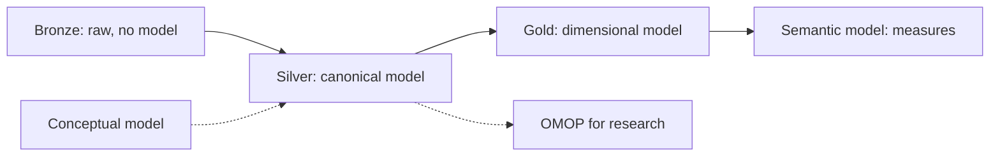

# Data Modelling Across the Medallion Layers

> Source: working conclusions from the Data & Healthcare Ecosystem learning project (dummy hospital in Microsoft Fabric), 2026-10-13.

## What it is

A way to place modelling techniques on top of the medallion layers. Medallion says how refined the data is; the modelling technique says how it is structured. They are not alternatives: you choose a style per layer.

## When to use it

When designing a lakehouse or data product and deciding what to model where, and when explaining why silver is not business-facing and why gold needs a [[Semantic Model]].

## Structure / steps

| Layer | Purpose | Modelling style | Healthcare example | Consumption |
|---|---|---|---|---|
| Bronze | Preserve the source | No model, raw and append-only | HL7, FHIR JSON, EPD exports | Technical only |
| Silver | Integrate and make trustworthy | [[Canonical Data Model]] (or [[Data Vault]]) | [[FHIR]]-like or [[OMOP]]-like tables | Data scientists, researchers |
| Gold | Make it usable | [[Dimensional Modelling]] (star schemas), or OMOP for research | `fact_stay` + dimensions | Reporting |
| On top of gold | Fix business meaning | [[Semantic Model]] | Measures such as length of stay, readmissions | Business users |

Steps:

1. Agree the concepts with the business: [[Conceptual Data Model]].
2. Fix the canonical model (own, standard or hybrid) and define shared definitions and code lists.
3. Write one documented mapping per source into the canonical model; silver cleans, harmonises, maps codes and links keys, but does not aggregate.
4. Derive gold: star schemas per domain (and an OMOP model if research is needed).
5. Define the semantic model on gold with measures and hierarchies.

Choosing silver style: a canonical model suits few to moderate sources and fast time-to-use; Data Vault suits many changing sources and strict audit needs.

## Diagram

## Inputs & outputs

- **Inputs:** source systems, conceptual model, chosen standard (FHIR/OMOP) or own definitions, code lists.
- **Outputs:** documented source-to-canonical mappings, star schemas, a semantic model with shared definitions.

## References

- Microsoft Healthcare Data Solutions in Fabric (medallion with FHIR/OMOP).
- OHDSI documentation on OMOP; HL7 FHIR specification.

## Links

- [[Medallion Architecture]]
- [[Canonical Data Model]]
- [[Conceptual Data Model]]
- [[Dimensional Modelling]]
- [[Data Vault]]
- [[Semantic Model]]
- [[FHIR]]
- [[OMOP]]
