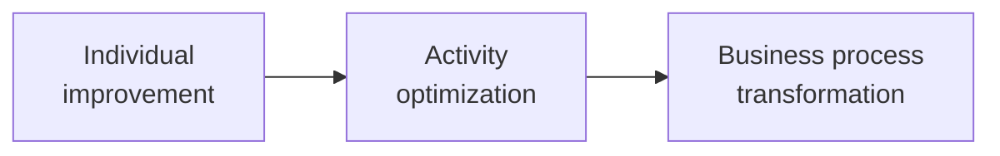

# Three Levels of AI Ambition

> One of three lenses in the Opportunity scan. Source: "AI Strategy and Operating Model" kickoff, 2026-02-09.

## What it is

A scale describing how far-reaching an AI initiative aims to be, from narrow personal gains to reshaping whole processes: **Individual improvement → Activity optimization → Business process transformation.**

## When to use it

During an Opportunity scan, to set and communicate the depth of change an initiative targets, and to balance quick individual wins against transformational bets.

## Structure / steps

1. **Individual improvement** — help individuals do their own work better.
2. **Activity optimization** — optimise a specific activity or task across people.
3. **Business process transformation** — redesign an end-to-end business process.

## Diagram

## Inputs & outputs

- **Inputs:** candidate use cases (ideally already classified by [[AI Value Creation — Three Ways to Add Value]]).
- **Outputs:** each use case placed on the ambition scale, informing sequencing (low-ambition wins early, transformation as a longer play).

## References

- AE "AI Strategy and Operating Model" kickoff deck, 2026-02-09.

## Links

- [[AI Strategy & Operating Model Approach]] — parent methodology.
- [[AI Value Creation — Three Ways to Add Value]] — pairs with this (kind of value × depth of change).
- [[AI Operating Model]]
